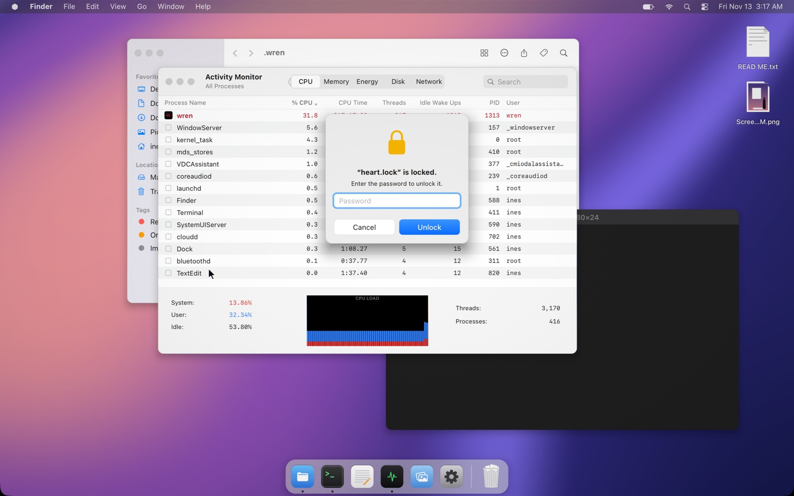

<p align="center"></p>

# Fake OS

**A horror puzzle game that pretends to be your Mac.**

Fake OS boots fullscreen into a convincing macOS-style desktop with its own Finder, Terminal, Activity Monitor, TextEdit, Preview, Dock, menu bar and Control Center. All of it is fake, and something in it is haunted. A program called **wren** has broken the machine's owner into 50 pieces and hidden them in the system. You get her back by poking at the fake OS: dim the screen, show hidden files, kill processes, read logs, talk to the thing in TextEdit.

Everything, including the cursor, is drawn by the game in Swift and Metal. It reads none of your files and changes nothing on your Mac.



## Download and play

1. Download **FakeOS.zip** from the [latest release](https://github.com/lydianb79/FakeOS/releases/latest) and unzip it.
2. The app isn't notarized, so the first time, **right-click FakeOS.app → Open → Open**. Or run:
   ```bash
   xattr -dr com.apple.quarantine FakeOS.app
   ```
3. Turn the sound on. Headphones are best.

Requires macOS 13 or later, on Apple silicon or Intel. **⌘Q always quits the real game.** Progress saves automatically. To start over, use the fake Apple menu → *Erase All Progress…*.

## What's inside

- **A fake macOS that behaves like one.** Draggable windows with working traffic lights, a magnifying Dock, menus, Control Center sliders, a Wi-Fi menu, notifications, Spotlight, desktop icons with rubber-band selection, and About This Mac.
- **Real-feeling apps.** Finder (with hidden files and the Trash), a Terminal with 25+ commands (`ls -a`, `ps`, `kill`, `grep`, `find`, `base64`, `man`, `say`…), Activity Monitor with live processes, TextEdit and Preview.
- **50 puzzles in six chapters.** Each one recovers a memory into `Recovered` on the desktop. A checklist tracks your progress, and the riddles for each chapter appear as notes from Ines.
- **A haunting that escalates.** Glitches, screen tears, a cursor that moves on its own, windows that shake, a clock stuck at 3:17 AM, and a ghost that types back.
- **Synthesized sound.** Rain, wind, a fridge, a laptop fan that spins down when you kill wren, footsteps upstairs, whispers in one ear and a heartbeat that speeds up. No audio files.
- **Two endings and a Congratulations screen.**

## How to play (no spoilers)

Start with **READ ME.txt** on the desktop and take it literally. Everything you can touch is a possible clue: the menu bar, the photos, the Wi-Fi names, the clock. Once you find Ines's notes, each chapter's riddles come from them. If you get stuck, wait: wren gets impatient and starts dropping hints. The full solution is at the bottom of this page.

## Run from source

```bash
swift run FakeOS                      # fullscreen
swift run FakeOS --windowed           # 1440×900 window
./build-app.sh && open dist/FakeOS.app
```

`build-app.sh` builds a universal (Apple silicon + Intel) `dist/FakeOS.app` and `dist/FakeOS.zip`. It renders the app icon from code and compiles it into an asset catalog (`Assets.car` + `AppIcon.icns`), and it stamps a build number. Set the version with `VERSION=1.2.0 ./build-app.sh`.

**Blank icon on a local build?** If Finder showed the app at that path before it had an icon, macOS can keep that cached blank icon. Fresh copies, like a downloaded release, are unaffected. To clear the cache:

```bash
sudo rm -rf /Library/Caches/com.apple.iconservices.store && killall Dock Finder
```

## How it's built

- **Metal** draws everything. Each window, popup and banner is painted into a Core Graphics canvas and uploaded as a texture. Metal then draws those as quads, with rounded corners and soft shadows done as SDFs in the shader. The wallpaper is a procedural shader, and the frosted Dock and menu bar sample it. A post-process pass adds the glitches, chromatic split, static, the tear line, display brightness and the glowing writing that only shows in the dark.
- **AppKit** is used only for the borderless fullscreen window, input, text and SF Symbols.
- **Sound** is all synthesized live in a stereo `AVAudioSourceNode`, with no audio files (`Audio.swift`, `Ambience.swift`). It's 3:17 AM in a quiet apartment: room tone, wind, rain on the window, a fridge next door that cycles on and off, and a laptop fan that runs as hard as wren does. Kill wren and the fan spins down for 30 seconds. As the haunting grows you'll hear creaking floorboards, footsteps upstairs, knocks, whispers panned into one ear, breathing, and a heartbeat that speeds up (and jumps while you type a password). Cars pass in the rain, thunder rolls, and the frozen clock ticks once and then stops. At the good ending the rain stops, birds come out and the clock finally ticks. There are also key clicks, glitch zaps, a chime for each recovered piece, a chord when each chapter opens, a boot chord and a flatline. Real macOS alert sounds are used for dialogs.

| File | What it does |
|---|---|
| `Renderer.swift`, `Shaders.swift`, `Canvas.swift` | Compositor, shaders, CG→texture |
| `World.swift` | Window manager, input routing, effects, endings |
| `Story.swift`, `Puzzles.swift` | Puzzle engine and the 50 puzzles, saves, scripted scares, ghost chat |
| `Spotlight.swift` | Spotlight search over the fake disk |
| `Audio.swift`, `Ambience.swift` | Stereo synth (ambience layers and 19 sound effects) and the director that drives it |
| `Finder`, `Terminal`, `ActivityMonitor`, `Windows` | Fake apps |
| `Desktop`, `Dock`, `MenuBar`, `Notifications` | Shell chrome |
| `FileSystem.swift` | Fake files and lore |
| `AppIcon.swift` | The app icon, drawn in code: the Dock icon at runtime, plus `Assets.car`/`.icns` via `build-app.sh` |

## The 50 puzzles

wren broke Ines into **50 pieces**. Each puzzle recovers one, saved as a memory in **Recovered** on the desktop (with an `INDEX.txt` checklist). They're grouped into six chapters, and each chapter opens when the one before it is complete. From chapter 2 on, Ines leaves the riddles as `part N.txt` in `~/.wren`. Progress saves automatically (Apple menu → *Erase All Progress…* starts over). Put Ines back with all 49 other pieces and you get the **Congratulations** screen.

<details>
<summary>Full solution (spoilers)</summary>

| # | Puzzle | Solution |
|---|---|---|
| **I** | **The Lights** | |
| 1 | Lights Out | Control Center → Display slider almost to zero |
| 2 | The Dotted Folder | Show hidden files (⌘⇧. or `ls -a`), open `~/.wren` |
| 3 | Thirty Seconds | Force-quit `wren` (Activity Monitor or `kill 1313`) |
| 4 | Heart | While wren is down, unlock `heart.lock` with `317` (the frozen clock) |
| 5 | Ask It Who It Is | In TextEdit, type "who are you" |
| **II** | **The Machine** | |
| 6 | Silence | Sound slider to zero |
| 7 | Old Habits | `history` |
| 8 | Whose Machine | `whoami` while wren is dead |
| 9 | Birthday | `cal` shows the 28th → `birthday.lock` = `28` |
| 10 | The Copy | Kill the fake `ines` process (pid 2811) |
| 11 | Fridge Magnets | `fridge.png` spells LUMEN → search "lumen" in Spotlight |
| 12 | MochiNet | Join Wi-Fi "MochiNet", password `mochi` |
| 13 | That Night | Click Finder, TextEdit, Terminal, Activity Monitor in the Dock, in that order |
| 14 | Count Them | Three people on the beach → `beach.lock` = `3` |
| 15 | Dreaming | Apple menu → Sleep |
| **III** | **The Archive** | |
| 16 | Encoded | `base64 -d note.b64` (in `~/Documents/archive`) |
| 17 | Backwards | `rev backwards.txt` |
| 18 | Buried | `grep ines wren.log` |
| 19 | Echo | `echo.lock` = `echo` |
| 20 | Lost Tooth | `find / -name tooth` |
| 21 | Call the Cat | `ping mochi` |
| 22 | Us | Open `us.png` in Trash → old_photos |
| 23 | Administrator | `sudo …` with password `wren` |
| 24 | The Manual | `man wren` |
| 25 | Awake | `uptime` |
| **IV** | **The House** | |
| 26 | What the Cat Sees | In `mochi.png`, click the eyes in the doorway |
| 27 | Handprint | In `IMG_3170.png`, click the handprint |
| 28 | By the Dock | In the desktop screenshot, click the figure |
| 29 | Power Source | Battery menu → Battery Settings… |
| 30 | Focus | Control Center → Focus |
| 31 | Three Taps | Click the menu-bar clock 3 times quickly |
| 32 | More Info | About This Mac → More Info… |
| 33 | Off and On | Apple menu → Restart… |
| 34 | All at Once | Drag a selection box around every desktop icon |
| 35 | Hide | Open 2+ windows and minimize them all |
| **V** | **The Voice** | |
| 36 | Where | Ask wren "where is ines" |
| 37 | Goodnight | Say "goodnight" |
| 38 | True Name | The installer in Downloads reveals HOLLOW → say "hollow" |
| 39 | Brave | Say "I'm not afraid" |
| 40 | What Time | Ask "what time is it" |
| 41 | Echo My Name | `echo ines` |
| 42 | Out Loud | `say ines` (really speaks) |
| 43 | Whispers | Open the Wi-Fi menu 5 times |
| 44 | Catch One | Click a wren notification |
| 45 | Three Deaths | Kill wren 3 times in total |
| **VI** | **Put Back** | |
| 46 | Fifty | `Recovered/final.lock` = `50` |
| 47 | Lights On | Display slider all the way up |
| 48 | Look at Me | Open the Trash |
| 49 | Say It Plainly | `ls ~/.Trash` |
| 50 | Put Back | Double-click `ines.self` in the Trash → Put Back → **Congratulations** |

Emptying the Trash at any point after the heart is unlocked triggers the bad ending, which erases your progress.
</details>

Dev helpers: `FAKEOS_SCENE=windows|dark|chat|ending|spotlight|congrats` stages a scene, `FAKEOS_SCENE=selftest` drives all 50 puzzles through the real game hooks and prints `SELFTEST RESULT …`, `FAKEOS_FRESH=1` ignores saved progress, and `FakeOS --render-audio out.wav` renders every ambience layer and sound effect offline for checking levels.
