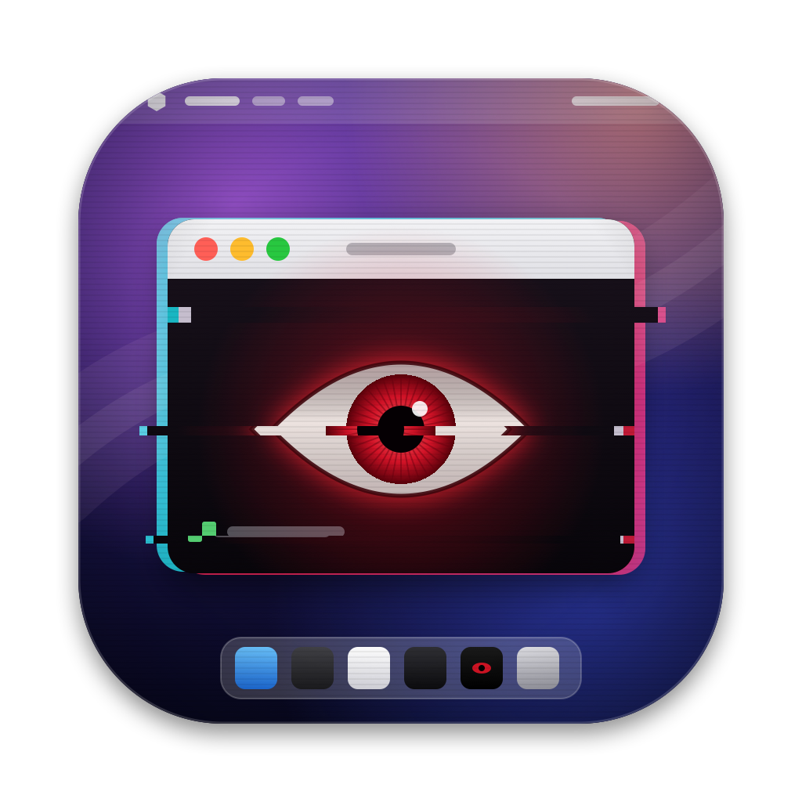

<p align="center"></p>

# Fake OS

A haunted fake macOS desktop built with Swift + Metal. Everything you see (the windows, files, Dock, menu bar, even the cursor) is drawn by the game. It reads no real files and touches nothing on your Mac.

## Run

```bash
swift run FakeOS                      # fullscreen
swift run FakeOS --windowed           # 1440×900 window for development
./build-app.sh && open dist/FakeOS.app
```

**⌘Q always quits the real game.**

## How it's built

- **Metal** draws everything. Each window, popup and banner is painted into a Core Graphics canvas and uploaded as a texture. Metal then draws those as quads, with rounded corners and soft shadows done as SDFs in the shader. The wallpaper is a procedural shader, and the frosted Dock and menu bar sample it. A post-process pass adds the glitches, chromatic split, static, the tear line, display brightness and the glowing writing that only shows in the dark.
- **AppKit** is used only for the borderless fullscreen window, input, text and SF Symbols.
- **AVAudioEngine** makes the procedural drone and static. Real system alert sounds are used for UI realism.

| File | What it does |
|---|---|
| `Renderer.swift`, `Shaders.swift`, `Canvas.swift` | Compositor, shaders, CG→texture |
| `World.swift` | Window manager, input routing, effects, endings |
| `Story.swift` | Puzzle state, scripted scares, ghost chat |
| `Finder`, `Terminal`, `ActivityMonitor`, `Windows` | Fake apps |
| `Desktop`, `Dock`, `MenuBar`, `Notifications` | Shell chrome |
| `FileSystem.swift` | Fake files and lore |
| `AppIcon.swift` | The app icon, drawn in code (Dock icon at runtime + `.icns` via `build-app.sh`) |

## Spoilers: the puzzle chain

1. `READ ME.txt` says *"It hides when the lights are on."* Turn Control Center → Display all the way down, and glowing writing appears.
2. Show hidden files (⌘⇧. in Finder, or `ls -a` in Terminal). Inside `~/.wren` are the diaries and `heart.lock`.
3. The diaries give two clues. Quitting wren frees files for 30 seconds. The password is the moment it happened: the frozen menu-bar clock, 3:17 (the Wi-Fi names whisper it too).
4. Kill `wren` in Activity Monitor (or `kill 1313`), then unlock `heart.lock` with `317` before it respawns.
5. `heart.txt` says *"Put me back."* Open the Trash and pick an ending: **Put Back** `ines.self` (good) or **Empty** the Trash (bad).

Dev scenes for screenshots: `FAKEOS_SCENE=windows|dark|chat|ending swift run FakeOS --windowed`.
